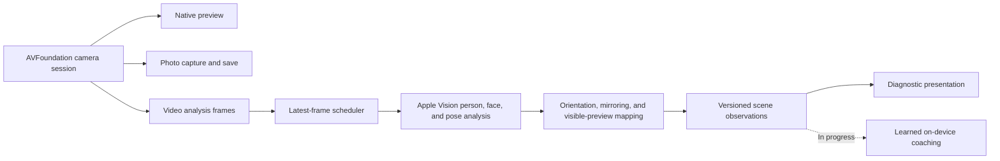
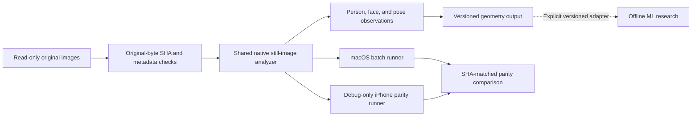
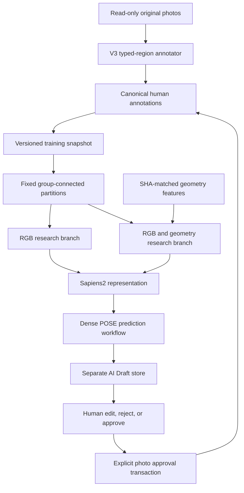

# Architecture

The native camera and offline ML research are separate components. A working camera does not depend on a trained composition model, and an offline research result does not establish on-device coaching readiness.

## iOS camera and live Vision

Camera-session changes belong to the camera service; UI state belongs to the main actor. Preview, zoom, focus, shutter, capture, save, and camera switching never wait for inference. The scheduler permits one in-flight inference and retains only the latest pending frame. Frame identity, camera generation, and expiry checks prevent stale results from reaching presentation.

Live observations use normalized coordinates in the visible preview, with a top-left origin. Orientation, front-camera mirroring, and the visible aspect-fill crop are applied at the adapter boundary. AI output cannot select physical lenses or take ownership of camera-session controls.

The scene-observation and scheduling infrastructure is implemented. Learned recommendations and Core ML integration are **in progress**. Existing mock coaching demonstrates a UI flow, not learned composition quality.

## Mac Geometry Exporter

The exporter reads originals without cropping, resizing, or re-encoding them. It verifies source identity and records Vision request revisions. Still-image geometry uses the EXIF-corrected full frame, with normalized coordinates and a top-left origin. This differs from the live pipeline's visible-preview coordinates.

The Mac runner and Debug-only iPhone runner share the still-image implementation. The recorded parity task covered 80 HEIC images with EXIF orientations 1 and 6. It verified that sample; it did not perform full-dataset extraction or validate every format and scene category.

The Apple Vision export schema is a separate contract. It is not a drop-in replacement for the detector-derived geometry used in the historical Geometry Ranker experiment. Feature ingestion requires an explicit, versioned adapter and original-image identity checks.

## Offline ML and human review

This diagram describes the POSE-only research workflow and its review boundary; it is not a deployment diagram. Ranking snapshots and localized problem-region snapshots have separate schemas and supervision rules. A ranking snapshot is not interchangeable with a V3 problem mask.

V3 stores typed rectangles in normalized, EXIF-oriented original-image coordinates. Display tiles are derived from that geometry. Changing the input profile or grid must not rewrite the annotations. Local problem types include POSE, hair/clothing, background objects, crop/edge, occlusion, local spacing, and other; a global problem is represented separately.

The POSE-only extension uses a single dense output channel. Explicit human POSE regions are positives; suitable BEST body regions provide clean references. Unmarked problem regions and other-type-only annotations remain unknown. Apple Vision geometry supplies features, not invented anatomical cause labels.

Draft generation writes suggestions and provenance to a separate store. It cannot approve a photo, declare BEST, or complete a group. Explicit human approval checks source identity and current annotation revisions before writing canonical labels. Empty model output is not BEST. Approval records model-assisted human confirmation, while group completion remains a separate human action.

Model qualification, review-time benefits, and production integration remain **in progress**.
